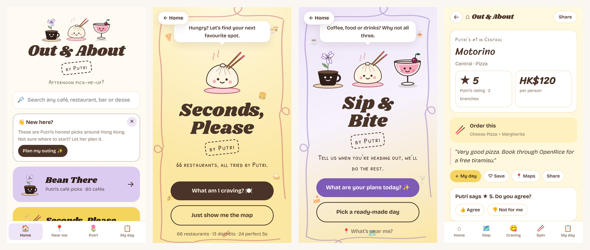

# Out & About

**[Open the live app](https://amabelnapitu.github.io/out-and-about/)** · best on a phone

A recommendation app for cafés, restaurants, bars and desserts in Hong Kong, built on my own
reviews of 160+ places. Visitors answer a few questions and get a personal % match on every
place, plan a day out with a walking route, and vote on my ratings. Behind it, a Google Sheets
pipeline keeps the data clean and checks Google Maps every month for places that have closed.



## What it does

| Feature | How it works |
|---|---|
| **Personal match scores** | Four-question quizzes (cravings, budget, spice, occasion; or bar vibe; or coffee taste) produce a 5-99% match for every place, with the top three reasons shown ("🪙 Under HK$100", "🌶️ Spicy, careful"). Each score starts from my rating and adds or subtracts points per answer, so every number can be explained. |
| **Day planner** | "What are your plans today?" turns the time of day and what you feel like into a sequence of stops (say lunch, something sweet, then coffee) and fills each with the best-scoring place near the previous one. Distance is scored, so routes stay walkable. |
| **Walking routes** | "Suggest an order" re-orders a saved list into the shortest walk (nearest-neighbour), choosing the closest branch of chains like % Arabica at each step, and opens the whole route in Google Maps. |
| **Near me** | Ranks places by distance from the phone's location or a chosen district, showing each chain once at its nearest open branch. |
| **Spin the wheel** | A random pick for the indecisive, weighted by rating squared so a 5★ place comes up about twice as often as a 3.5★ one. |
| **Votes and suggestions** | Visitors agree or disagree with each rating, suggest places and report closures. These go to the sheet, and I get an email for each. |
| **Works offline, syncs across devices** | Installable as a phone app (PWA), opens without signal, and Google sign-in syncs saved places between devices. Two devices' lists are merged on first sign-in, then the newest change wins. |

## The data pipeline

```
 Google Sheet (my reviews)          Apps Script (1,000 lines)            The app
 ─────────────────────────          ─────────────────────────            ───────
 Cafe / Restaurant / Bar /   ──►    sync review tabs → app tabs   ──►    published CSV
 Dessert review tabs                rank top 3 per district              (falls back to the
                                    infer tags, geocode places           saved copies in data/)
                                    monthly: Google Places API
                                      → find every branch               votes, notes
                                      → tag closed places      ◄──────  (web app endpoint)
```

- **Single source of truth.** I only ever edit my review tabs. A script copies changes into
  clean "app" tabs, highlights anything needing attention, fills in coordinates, and re-ranks
  each district's top three (highest rating, 4+ only, never closed).
- **Data quality.** Once a month the script looks every place up with the Google Places API,
  records each branch (338 so far), and tags a place `closed` only when every branch is
  permanently closed, or `temp-closed` when none is open. It filters out same-named shops of
  the wrong type, so a closed café isn't kept alive by an unrelated restaurant. It emails a
  summary of what changed.
- **Resilience.** If the sheet can't be reached, the app uses the CSV snapshots in `data/`.

The Apps Script lives in the sister project
[Bean There](https://github.com/Amabelnapitu/bean-there-by-putri/blob/main/apps-script/Code.gs),
the café app this one grew out of.

## Built with

| Layer | Technology |
|---|---|
| Front end | Plain JavaScript, HTML and CSS: no framework, no build step (`app.js`, about 1,350 lines) |
| Data | Google Sheets published as CSV; a small CSV parser in the app |
| Back end | Google Apps Script web app (votes, notes, sync, monthly checks) |
| APIs | Google Places API (branches and closures), Google Maps (directions) |
| Accounts and sync | Firebase Authentication (Google sign-in) and Cloud Firestore, with per-user security rules |
| Offline | Service worker and web app manifest |
| Hosting | GitHub Pages; everything runs on free tiers |

## Run it locally

```bash
python3 -m http.server 8000
```

Then open http://localhost:8000.

## Repository

| Path | Contents |
|---|---|
| `app.js` | The whole app: data loading, scoring, routing, views, sync |
| `config.js` | Links to the published sheet tabs, the Apps Script endpoint and the Firebase project |
| `data/` | CSV snapshots of each tab, used when the sheet is unreachable |
| `sw.js`, `manifest.webmanifest` | Offline support and phone installation |
| [`docs/MAINTAINING.md`](docs/MAINTAINING.md) | The owner's manual: sheet columns, tags, sign-in setup, deployment |
